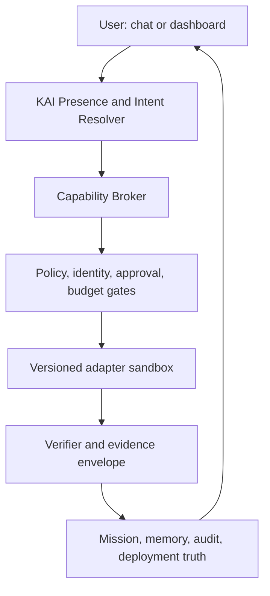

# KAI Capability Exchange

## Deep-research integration blueprint and Claude Code mission

**Decision date:** 11 September 2026  
**Selected strategy:** Staged foundation  
**Scope:** Consolidated assessment of the full screenshot set, current KAI constraints, a governed integration architecture, rollout sequence, and an executable Claude Code prompt.

---

## 1. Executive decision

Do not install the screenshot projects wholesale and do not introduce another agent framework as KAI's peer. Build a **KAI Capability Exchange** on top of KAI's existing Capability Fabric, CapabilityBrain, ModelRouter, Mission system, OperationalSelfModel, HoldingDigitalTwin, identity and tenant controls, policy and approval controls, evidence system, Feature Registry, KAI Presence, dashboard, and deployment truth.

The exchange should let KAI discover, review, activate, invoke, observe, and revoke external capabilities through one KAI-owned contract. External projects remain replaceable implementations. KAI remains the only brain, authority plane, mission owner, memory authority, and source of user-visible truth.

The practical order is:

1. Close the currently known security and route-completeness findings.
2. Implement the capability manifest, registry, broker, policy/evidence envelope, lifecycle, kill switch, and dashboard surfaces without enabling new external execution.
3. Pilot a small engineering and research pack: AG-UI bridge, specification workflow patterns, selected composable coding skills, read-only GitHub/Context7/Sentry connectors, one diagram adapter, and one local document-ingestion adapter.
4. Add business automations only as draft-and-approve workflows.
5. Add media generation and voice adapters after provenance, consent, cost, and safety controls exist.
6. Keep finance in research, simulation, and paper-trading modes until a separate capital-risk authorization program is complete.
7. Keep physical-device, home, mobile, offensive-security, uncensored-model, and self-modifying systems outside production by default.

This gives the user one normal KAI experience: ask KAI in chat or use a UI control; KAI resolves the intent, explains what it will do, requests approval when required, invokes the adapter, verifies the outcome, records evidence, and presents a result. The user should never need to know which provider supplied the capability unless they open details.

---

## 2. Facts, assumptions, and evidence standard

### 2.1 Evidence rules

The screenshots are discovery material. Their descriptions, star counts, benchmark claims, download totals, dates, security claims, and performance claims are not treated as verified facts unless an official source supports them. Counts are deliberately omitted from architectural decisions because they change quickly and do not establish fitness or safety.

Each candidate has one of five dispositions:

- **Adapt first:** use a protocol, pattern, or tightly scoped adapter in the first pilot wave.
- **Pilot later:** useful, but requires a foundation, license review, isolation, a stronger business case, or specialist validation.
- **Reference only:** mine ideas or tests; do not run it as a KAI authority.
- **Defer/reject:** currently incompatible with KAI's safety, authority, legal, hardware, or operational model.
- **Unverified:** the screenshot did not expose an unambiguous official identity, license, or reproducible claim.

No candidate moves from discovery to use because of popularity. Admission requires an official source, pinned revision, license decision, dependency and secret scan, threat model, data-flow review, test evidence, owner, rollback path, and explicit activation decision.

### 2.2 Current KAI constraints that bind this plan

The latest shared KAI context establishes these non-negotiable constraints:

- KAI is the only brain and authority plane. No second orchestrator, mission state machine, memory authority, policy engine, or knowledge authority may be introduced.
- PR #82 is not approved. Three HIGH findings remain: a voice page sends refused JWT query tokens; the cookie-origin allowlist omits the CORS fallback; and the router manifest omits chat, memory, RAG, skills, and trading mounts.
- PR #81's preview succeeded, but route-completeness and WebSocket-auth tests remain weak.
- The Capability Fabric catalog owner gate can be bypassed through sibling routes.
- The Holding dark-launch branch has privilege problems, and unauthenticated `/admin` JSON exposes telemetry, secrets-configured providers, business metrics, and scheduler state.
- A2 worktree tests inherit runner credentials and network access.
- Governed Browser Runtime had WebSocket and service-worker egress bypasses. Candidate fixes block service workers and gate WebSockets, but certification is not yet established.
- KAI Computer Operations is deployed but has no enrolled devices; execution is disabled. A Mac mini M4 can become a narrow test node only after attestation, signing/notarization, TCC controls, and explicit enrollment.
- Apple Developer enrollment for SOLCIRCLE TECHNOLOGIES LLC remains pending verification.
- The current Claude checkpoint is `4d7999d` on an isolated cyber-operations branch. It is a checkpoint, not proof that later phases are complete.

These findings make security closure **Stage 0**, ahead of new capability execution.

---

## 3. Architectural answer: KAI Capability Exchange



The Capability Exchange is not a new autonomous agent. It is the governed layer that connects KAI-owned intents to replaceable providers. It should reuse existing KAI infrastructure and add only the missing contracts and surfaces.

### 3.1 Canonical capability manifest

Every skill, adapter, provider, runtime, connector, UI bridge, or reference implementation needs a machine-readable manifest. The schema should be versioned and validated at ingest and boot.

Minimum fields:

| Field | Purpose |
|---|---|
| `id`, `display_name`, `version`, `kind` | Stable identity; `kind` is `skill`, `adapter`, `provider`, `runtime`, `connector`, `ui_bridge`, or `reference` |
| `owner`, `maintainers` | Accountable KAI owner and escalation path |
| `source_url`, `pinned_revision`, `artifact_digest` | Reproducible source and supply-chain identity |
| `license_spdx`, `license_review` | Legal classification and approved use mode |
| `sbom`, `provenance`, `signatures` | Dependency inventory and build provenance |
| `intents`, `input_schema`, `output_schema` | What KAI may ask it to do and exact data contracts |
| `data_classes`, `retention`, `residency` | Data handling boundaries |
| `permissions`, `secrets`, `network_domains` | Least-privilege runtime envelope |
| `execution_mode`, `isolation`, `risk_tier` | Read, draft, approve/execute, or prohibited; process/container/remote isolation |
| `approval_policy`, `budget_policy` | Required human approval and spend/time/token limits |
| `healthcheck`, `timeouts`, `rate_limits` | Operational behavior |
| `evidence_contract`, `redaction_policy` | Required receipts without leaking secrets or sensitive data |
| `rollback`, `kill_switch`, `degradation` | Safe disablement and fallback |
| `status`, `reviewed_at`, `expires_at` | Lifecycle and mandatory re-review |

Use an explicit lifecycle:

`DISCOVERED → VERIFIED_SOURCE → REVIEWED → LAB → STAGING → PROD_INERT → PROD_ACTIVE`

Any stage may transition to `QUARANTINED`, `REVOKED`, or `REJECTED`. Promotion must be impossible through an undocumented sibling route. Server-side authorization must be shared across all mutation paths.

### 3.2 Capability broker

The broker receives a KAI-owned intent rather than arbitrary provider commands. It should:

1. Resolve the requested capability and candidate adapters.
2. Filter by tenant, identity, policy, data class, risk, residency, health, license, and budget.
3. Select an approved adapter using deterministic routing rules.
4. Produce a preflight plan with requested permissions and expected external effects.
5. Request approval when the execution class requires it.
6. Invoke through a sandbox with scoped credentials and network allowlists.
7. Verify postconditions independently of provider prose.
8. emit a redacted evidence envelope and update mission state.

Provider output is untrusted data. It cannot directly mutate KAI policy, memory authority, mission status, capability status, or user identity.

### 3.3 Four execution classes

| Class | Examples | Default behavior |
|---|---|---|
| Observe/read | Search docs, inspect logs, read repository files | May run unattended only with narrow scopes and safe data classes |
| Draft/propose | Draft an email, issue, invoice, post, code patch, or trade hypothesis | May produce an artifact; cannot send, merge, publish, pay, or trade |
| Approve/execute | Deploy, send, merge, change schema, issue refund, publish, place an order | Named approval, fresh auth, idempotency key, limit checks, receipt, rollback where possible |
| Prohibited/unavailable | Credential theft, spam, bypassing bot controls, unauthorized intrusion, unbounded self-modification | Refuse and record a policy event |

### 3.4 Evidence envelope

Every invocation should return an envelope independent from the adapter's natural-language output:

```json
{
  "mission_id": "...",
  "capability_id": "...",
  "adapter_version": "...",
  "decision": "allowed|approval_required|denied|failed|completed",
  "policy_revision": "...",
  "principal": "...",
  "tenant": "...",
  "requested_effects": [],
  "approved_effects": [],
  "inputs_digest": "...",
  "outputs_digest": "...",
  "external_receipts": [],
  "verification": {"status": "...", "checks": []},
  "cost": {"currency": "USD", "amount": 0, "tokens": 0},
  "started_at": "...",
  "completed_at": "...",
  "redactions": [],
  "rollback_ref": null
}
```

Receipts establish what happened; they do not automatically prove correctness. Verification should query an authoritative system where possible—for example, deployment status from the hosting provider, the created issue by its returned identifier, or a database schema checksum after a migration.

### 3.5 AG-UI as a presentation bridge, not authority

[AG-UI](https://github.com/ag-ui-protocol/ag-ui) is a lightweight event-based protocol for agent/user interaction. Its official repository describes streaming chat, bidirectional state, structured or generative UI, context enrichment, frontend tools, and human-in-the-loop patterns across transports such as SSE and WebSockets. It is complementary to MCP and A2A.

KAI should adapt a **strict subset** of AG-UI events at its frontend boundary. The bridge translates KAI mission events into UI events and validates client responses against KAI schemas. Client-supplied state and tool events remain untrusted. Authentication, tenant isolation, policy, approvals, evidence, and mission state stay inside KAI. AG-UI's flexible event matching must not weaken KAI's explicit schemas.

### 3.6 MCP gateway

MCP connectors are powerful because they expose both reads and mutations. KAI should never add a server directly to a global agent configuration and implicitly trust all tools.

The MCP gateway should maintain per-connector profiles with:

- an exact server identity and pinned deployment;
- OAuth or short-lived project credentials, never query-string bearer tokens;
- project and tenant scoping;
- explicit tool allowlists;
- read-only as the default;
- data-class and domain restrictions;
- manual approval for mutations;
- output labeling as untrusted content;
- prompt-injection defenses and separation of instructions from retrieved data;
- timeouts, rate limits, spend limits, kill switches, and auditable receipts.

This is consistent with official guidance. The [GitHub MCP Server](https://github.com/github/github-mcp-server) supports toolsets, individual tool allowlists, and a read-only mode that overrides write tools. [Supabase's MCP guidance](https://supabase.com/docs/guides/ai-tools/mcp) explicitly recommends project scoping, read-only access, restricted feature groups, manual approval, development branches, and treating prompt injection as a primary risk. Its guidance also says unattended routines should stop and recommend rather than perform a write.

### 3.7 Skill registry

Skills are instruction packages, not trusted code merely because they are Markdown. Admission should statically inspect instructions, scripts, hooks, network access, referenced binaries, mutable downloads, hidden prompt behavior, and permission requirements.

KAI should selectively adapt small, composable skills. The [Matt Pocock skills repository](https://github.com/mattpocock/skills) explicitly favors small composable skills over process-owning frameworks and warns that installing both plugin and skill forms duplicates behavior. Useful patterns include document grilling, spec creation, ticket conversion, implementation, wayfinding, TDD, debugging, code review, architecture surveys, research, and handoff. [GitHub Spec Kit](https://github.com/github/spec-kit) provides a useful specification-driven development model. [gstack](https://github.com/garrytan/gstack) is a broad Claude Code setup whose individual roles and checks may be mined, but it should not become a second operating system for KAI.

No skill may grant itself new permissions, rewrite its approval class, modify production policy, persist unaudited memory, install mutable dependencies at runtime, or silently auto-update.

### 3.8 Memory gateway

KAI must retain one memory authority. Memory products may be evaluated as storage, extraction, ranking, or retrieval adapters only.

[Mem0](https://github.com/mem0ai/mem0) is Apache-2.0 and exposes self-hosted and managed memory options. Its current official documentation also distinguishes proprietary managed-platform optimizations from the open-source SDK, so reported managed benchmarks should not be projected onto a KAI deployment. [OpenViking](https://github.com/volcengine/OpenViking) combines memory, RAG, and skills, but its main project is AGPLv3 and describes itself as self-evolving; that creates authority and licensing conflicts. It belongs in an isolated evaluation, not the first foundation.

All memory adapters must implement provenance, subject and tenant isolation, correction, deletion, retention, consent, confidence, contradiction handling, and audit. A provider may propose memories; only KAI's memory policy may accept them as authoritative.

### 3.9 Model routing

Keep the existing ModelRouter. FreeLLMAPI, OmniRoute, Switchyard, Dify model management, and similar gateways overlap it. Evaluate at most one routing adapter against a fixed conformance suite if a concrete gap exists. Do not stack multiple gateways: compounded retries, quota interpretation, logging, data residency, and fallback behavior become difficult to reason about.

Model choice must remain constrained by task class, data class, region, policy, health, context size, latency target, quality evidence, and budget. “Free” models are not free of confidentiality, reliability, rate-limit, licensing, or operational costs.

---

## 4. Consolidated candidate disposition

This matrix consolidates every distinct capability family visible in the screenshots and OCR. Repeated slides and duplicate mentions are collapsed. “Reference” means useful ideas may be extracted after source verification; it does not mean the project is approved software.

### 4.1 First-wave candidates

| Candidate | Disposition | KAI use | Boundary |
|---|---|---|---|
| AG-UI | Adapt first | Strict event bridge for streaming, progress, approvals, artifacts, and generative UI | UI protocol only; no policy or mission authority |
| GitHub Spec Kit | Adapt first | Specification and acceptance-criteria workflow | Pattern/templates; KAI missions remain canonical |
| Matt Pocock skills | Adapt first | Curated engineering skill pack | Selective import, pinned and reviewed; no duplicate plugin installs |
| GitHub MCP Server | Pilot first, read-only | Repository, PR, issue, action, and security context | Minimal tool allowlist; mutations require separate approval profile |
| Context7 | Pilot first, read-only | Current library documentation retrieval | Retrieved text is untrusted; source and version must be shown |
| Sentry MCP | Pilot first, read-only | Production error diagnosis and issue context | No automatic code/deploy mutation |
| AnyDoc | Pilot first, local | Convert office documents to Markdown before KAI ingestion | MIT; sandbox; OCR is a separate hosted/data-egress decision |
| Diagram Design **or** Archify | Pilot one | Generate governed diagrams from an approved spec | Evaluate accuracy and deterministic export; do not install both first |
| React Scan | Dev-only pilot | Detect React rerenders in test/dev | Never ship its diagnostic instrumentation unintentionally |
| OpenAI Codex | Governed executor | Isolated coding execution under KAI missions | Tool, not brain; no protected writes or deployment authority |
| DeepSeek Harness | Keep pinned/current | Existing plugin-capable harness where KAI already uses it | Officially developer preview with breaking changes; pin and certify every upgrade |

DeepSeek's official repository calls [DeepSeek Harness](https://github.com/deepseek-ai/DeepSeek-Harness) a developer preview and warns of compatibility-breaking changes. Its “everything is a plugin” architecture supports KAI's adapter direction, but it is not a reason to make every plugin production-active.

### 4.2 Agent frameworks and workflow builders

| Candidates | Disposition | Reason |
|---|---|---|
| CrewAI, Microsoft AutoGen, MetaGPT, AutoGPT | Reference only | They are orchestration or multi-agent frameworks and would duplicate KAI's brain, delegation, memory, and mission authority |
| LangChain / LangGraph / Deep Agents | Reference or narrow library adapter | Reuse isolated utilities only where they fill a measured gap; do not create a second graph authority |
| Dify, Langflow, Sim, Ruflo, OpenCompany, OpenClaw, Hermes Agent, The Org Chart, pi, prime-agent, orca | Reference/lab | Broad agent platforms or autonomous runtimes overlap KAI's control plane; extract UX, test, or adapter ideas |
| n8n | Pilot later as an execution backend | Valuable connector coverage, but it is fair-code, has its own workflow runtime, and must remain subordinate to KAI missions and approvals |
| JIT-Agent, OpenClaude, “250 agents,” promotional benchmark harnesses | Unverified/reference | Exact identity, version, license, and claims were not sufficiently established from the screenshots |

[Dify](https://github.com/langgenius/dify) combines workflows, RAG, agents, model management, observability, and APIs; this breadth makes it a reference or subordinate adapter, not KAI's replacement. [n8n](https://github.com/n8n-io/n8n) provides a visual automation platform and extensive integrations, but the repository uses its Sustainable Use License and Enterprise License rather than an OSI-style permissive license. Legal and architectural review must precede any embedding or service offering.

### 4.3 Memory, RAG, documents, and research

| Candidates | Disposition | KAI use or concern |
|---|---|---|
| Mem0 | Pilot later | Retrieval/extraction adapter behind KAI memory authority |
| OpenViking | Lab only | AGPLv3 main project; self-evolving memory/RAG/skills overlaps three KAI authorities |
| Open Notebook | Pilot later or reference | MIT, private multi-model notebook, multimodal organization, search, chat, podcasts; useful research-space patterns |
| AnythingLLM, LibreChat | Reference | Private document/chat UX patterns; duplicate KAI's user-facing assistant surface |
| LlamaIndex, RAGFlow | Narrow adapter/reference | Ingestion and retrieval components only; KAI remains knowledge authority |
| agentmemory, supermemory, MemPalace, TencentDB-Agent-Memory, claude-context | Lab | Benchmark, privacy, license, deletion, and tenant-isolation evaluation required |
| AnyDoc | First-wave local pilot | Deterministic document-to-Markdown boundary; scanned OCR requires separate path |
| Firecrawl, `pdf-inspector`, MarkItDown | Pilot later | Web/document extraction with provenance, egress, file-size, and hostile-document controls |
| Book-to-Skill, Understand Anything, Hyper Research | Reference/lab | Useful retrieval and research workflow ideas; do not allow generated skills to self-activate |

[Open Notebook](https://github.com/lfnovo/open-notebook) is MIT-licensed and describes private, multi-provider, multimodal research with full-text and vector search. [AnyDoc](https://github.com/firecrawl/anydoc) is MIT-licensed, runs locally for supported documents, and separates scanned-page OCR into a hosted service. That boundary is suitable for an explicit KAI data-egress decision.

### 4.4 Browser, scraping, MCP, and device control

| Candidates | Disposition | KAI boundary |
|---|---|---|
| Existing Governed Browser Runtime | Complete certification first | Fix and prove WebSocket/service-worker egress controls before expansion |
| Playwright MCP | Dev/test adapter | Browser semantics and deterministic testing; governed browser still owns network and approval policy |
| Chrome DevTools MCP | Dev/test adapter | Diagnostics and performance inspection only |
| Stagehand, browser-use | Reference/lab | Useful browser-agent patterns but overlap runtime control |
| Firecrawl, Scrapling | Pilot later | Public-web extraction with allowlists, robots/terms review, throttling, and evidence |
| Camofox | Reject bypass use | Do not use to evade anti-bot controls or site restrictions |
| GitHub, Context7, Sentry, Supabase, Vercel, Neon MCP | Connector-by-connector pilots | Read-only/project-scoped first; deployment or schema mutations require explicit approval profiles |
| Docker MCP catalog, Awesome MCP Servers, Public APIs | Discovery only | A catalog is not a trust root; every server is independently reviewed |
| Agentic Inbox | Pilot later | Treat inbound email as hostile content; drafts only before send approval |
| Artemis, vphone-cli, potato-mesh | Lab only | Mobile/device automation has entitlement, signing, privacy, and remote-control risk |
| Home Assistant | Pilot much later | Narrow home intents with local auth, device allowlists, confirmation, and physical-safety rules |
| ProxyCloud | Defer | A VPN changes KAI's network trust and evidence boundary; separate infrastructure/security review required |

[Playwright MCP](https://github.com/microsoft/playwright-mcp) and [Chrome DevTools MCP](https://github.com/ChromeDevTools/chrome-devtools-mcp) are appropriate development aids, not a reason to bypass the Governed Browser Runtime. [Vercel MCP](https://vercel.com/docs/agent-resources/vercel-mcp) exposes documentation, project/deployment management, logs, and analytics via OAuth and remains beta; KAI should separate public/read-only tools from authenticated mutation tools.

### 4.5 Software-engineering and design skills

| Candidates | Disposition | Notes |
|---|---|---|
| PRD, UI/UX brief, security audit, debugging, E2E, refactor, commits, task-to-skill, docs skills | Adapt first as KAI-owned profiles | Encode exact inputs, artifacts, tests, and stop conditions |
| Diagram Design, Archify, ponytail | Evaluate then select | Choose by accuracy, supported outputs, dependency surface, and license |
| No AI Slop, I Have ADHD, Humanizer, Stop Slop | Reference | Convert desirable style rules into KAI-owned writing profiles; avoid hidden global prompt changes |
| UI/UX Pro Max, Impeccable, Taste Skill | Reference/selective skill | Extract testable design heuristics; do not treat “taste” claims as objective evidence |
| Frontend Slides | Reference | Existing presentation workflow should remain authoritative |
| Thumbnail Maker, Premium Web App Builder, Client System | Reference | Convert into scoped templates only when a user requests the workflow |
| Serena | Lab/reference | Semantic code retrieval/editing can complement repository tools, but write operations need the same mission controls |
| TopRank, OpenSEO, Claude Ads, AI Job Search | Pilot later | Separate domain workflows with data, consent, platform, and approval constraints |
| Context Mode / ClawRouter | Reference | Evaluate context-compression ideas inside existing ModelRouter; do not insert another router |

### 4.6 UI and application libraries

| Candidates | Disposition | Notes |
|---|---|---|
| shadcn/ui, React Aria | Preferred references | Composable UI plus accessibility primitives; follow KAI's existing design system and dependency policy |
| Material UI, Ant Design, Chakra UI | Do not mix wholesale | Mature alternatives, but adding multiple design systems fragments theming, bundle size, and accessibility ownership |
| React Bits, Skiper UI, Vengeance UI, Animmaster, Uiverse | Selective lab | Copy only audited components that improve a measured interaction; motion must respect reduced-motion and performance budgets |
| TanStack Query | Use if already aligned | Good server-state boundary; avoid duplicating an existing data layer |
| Zustand | Use only for proven local-state gap | Do not create a second global source of truth |
| React Hook Form | Use for complex forms if compatible | Preserve server-side validation and accessibility |
| React Scan | Dev-only first wave | Performance diagnostic, not production capability |
| Tauri | Evaluate for signed desktop shell | Requires a distinct desktop security model and updater/signing review |
| Flask | Reference/narrow services | Do not add a second web framework without a repository-specific reason |
| TermUI Registry, cmux, scriptc.dev | Developer-experience lab | Useful only if they match supported platforms and a measured need |
| Shaper | Analytics reference/pilot later | SQL-first dashboards must honor row/tenant controls and query budgets |

### 4.7 Media, visual, voice, and 3D

| Candidates | Disposition | KAI boundary |
|---|---|---|
| Existing KAI Visual Creation Studio | Continue as authority | OpenAI image primary with governed provider adapters and unique preset registry |
| Open Generative AI / Open-Higgsfield-AI | Reference/lab | Aggregator claims and provider terms require verification; do not become another media control plane |
| ComfyUI | Local lab/runtime adapter | Workflow execution behind manifest, model provenance, VRAM checks, and file sandbox |
| HyperFrames, sprite-gen | Pilot later | Useful video/sprite pipelines; preserve provenance and asset manifests |
| Qwen3-TTS | Pilot later | Voice design/TTS only after model license, consent, impersonation, and watermark/provenance review |
| LTX-2 Distilled | Pilot later | Image-to-video behind content provenance and resource limits |
| TripoSplat | Pilot later | 3D generation with asset-license and geometry/file safety checks |
| Omni Editor | Unverified/pilot later | Official identity, privacy, model providers, terms, and retention need verification |
| Recordly, Cap | Pilot later | Screen-recording/editor tools can support demos; protect secrets and private on-screen data |
| Meetily | Pilot later | Meeting capture requires participant notice, consent, retention, and access controls |
| ComfyUI Ref2VA-VSA | Defer on Mac mini | Screenshot specifies RTX 4090/24 GB-class requirements; incompatible with the proposed Mac mini node without another compute target |

Generated or cloned voices must never be presented as a real person's authentic speech without explicit consent and disclosure. Media adapters should record prompt and input digests, model/version, seed where available, provider receipt, transformations, content warnings, and export license.

### 4.8 Finance, trading, and market analysis

| Candidates | Disposition | Permitted initial mode |
|---|---|---|
| skfolio | Research pilot | Portfolio construction, risk, stress testing, and reproducible notebooks |
| Kronos | Research lab | Financial-model evaluation with dataset, leakage, drift, and calibration tests |
| NautilusTrader | Simulation/paper-trading lab | Deterministic event-driven backtesting and paper execution only |
| TimesFM | Research lab | Forecast baseline; no direct trading authority |
| FinceptTerminal | Research/reference | Market-data and terminal UX patterns |
| TradingAgents, Vibe-Trading | Reference/lab | Agent patterns only; no brokerage credentials or capital |
| Sure personal finance | Defer/legal review | AGPL and highly sensitive financial-data boundary |
| AI strategy search lab and deflated Sharpe workflow | Adapt as validation pattern | Require data-snooping controls, out-of-sample tests, trial counts, costs, and reproducibility |
| Alpaca, IBKR, Binance, Webull, Longbridge, LONA, TradingCursor plugins | Not connected in foundation | Data-only sandbox may be separately authorized; no order placement |

[NautilusTrader](https://github.com/nautechsystems/nautilus_trader) spans research, deterministic simulation, and live execution, and explicitly notes that live behavior can diverge from simulation. Its current v2 line is a release candidate and the project warns against production use controlling real capital. Its LGPL-3.0-only license also requires review. [skfolio](https://github.com/skfolio/skfolio) is a more suitable early research component for portfolio optimization and risk analysis.

KAI must have a hard capital firewall: no live brokerage credentials, withdrawals, transfers, leverage changes, options approval changes, or real orders in these stages. Paper-trading events must be unmistakably labeled and stored separately from real positions. Financial outputs are decision support, not guaranteed advice.

### 4.9 Business automation and communications

| Workflow family | Disposition | Required control |
|---|---|---|
| Invoice extraction and draft creation | Early business pilot | Validate vendor, amount, currency, tax, duplicates, and PO; approval before posting/payment |
| Support triage and FAQ | Early business pilot | Draft or classify first; redact sensitive data; confidence-based escalation |
| Research and lead enrichment | Pilot later | Licensed sources, purpose limitation, opt-out/suppression, provenance |
| Outreach and follow-ups | Pilot later | Human approval, identity, consent/legal rules, rate limits, suppression lists; no bulk spam |
| Team summaries and Notion/Slack updates | Pilot later | Read/write separation and channel/recipient verification |
| Voice-call agent | Late pilot | Recording and AI disclosure, consent, jurisdiction, escalation, DNC controls |
| Content repurposing, avatar, faceless video, autoposting | Draft-only first | Provenance, rights, platform terms, review; publishing disabled by default |
| Stripe invoicing/payment workflows | Separate payment integration | Idempotency, webhook verification, least privilege, human approval, reconciliation |

n8n screenshots are valuable as workflow requirements, not as proof that each workflow is safe or production-ready. KAI should represent each as a mission template and optionally use n8n as a subordinate execution adapter after licensing review. KAI must own state, approvals, identity, evidence, and retries.

### 4.10 Other applications and references

| Candidates | Disposition | Notes |
|---|---|---|
| Novu | Pilot later | Notification delivery adapter; verify tenant isolation, templates, preferences, and unsubscribe behavior |
| Papermark | Pilot later | Document-sharing adapter with access, tracking disclosure, expiry, and revocation controls |
| OpenReplay | Pilot later | Session replay has substantial privacy/redaction requirements |
| Devopness | Reference/pilot later | Infrastructure execution requires strong project scoping and approval |
| Ruddarr, MoonBase template, Kado | Reference | Product/UI patterns; do not import as KAI capabilities |
| omarchy | Defer | Linux-focused environment is not the Mac mini execution plan |
| Needle, MiniMind, zero-to-SGLang, local-model lists | Research lab | Hardware, license, model quality, and supply-chain evaluation needed |
| Ollama, llama.cpp, vLLM | Provider candidates | Mac mini favors Ollama/llama.cpp-style local inference; vLLM typically fits separate accelerator infrastructure |
| Free-for-dev, Awesome lists, Public APIs, startupideasdb, CodePen, Exercism, Resumake, Readme.so, Quickref, Roadmap.sh, freeCodeCamp | Discovery/reference | Never bulk-trust or auto-install catalog entries |
| HuiHui “abliterated/uncensored” models | Reject for production | At most an isolated, offline, explicitly authorized red-team evaluation with no secrets or external actions |
| DarkGPT, locally-uncensored, pentest-agents | Reject or isolated authorized security lab | No operational use without explicit target authorization, written scope, containment, and evidence |

---

## 5. Staged delivery plan

### Stage 0 — security and truth closure

No new capability execution is enabled.

Required outcomes:

1. Resolve PR #82's three HIGH findings and produce tests for refused query-token auth, shared cookie/CORS origin evaluation, and complete route registration.
2. Strengthen route-completeness and WebSocket-auth tests from PR #81.
3. Apply one server-side owner gate to every capability-catalog mutation route and prove sibling routes cannot bypass it.
4. Remove or authenticate the unauthenticated Holding `/admin` JSON and regression-test that telemetry, provider configuration, metrics, and scheduler state cannot leak.
5. Prevent A2 untrusted worktree tests from inheriting runner credentials or unrestricted network.
6. Certify Governed Browser Runtime service-worker and WebSocket egress controls with negative tests.
7. Verify deployed artifact, route map, commit SHA, migrations, and rollback—not merely CI success.

Exit gate: zero unresolved HIGH findings in these surfaces, security tests green, independent route inventory matches the router manifest, and production truth is recorded.

### Stage 1 — inert Capability Exchange foundation

Build and test:

- `CapabilityManifest` schema and versioning;
- registry persistence and lifecycle;
- centralized authorization shared by every route;
- broker resolution and policy preflight;
- approval and budget hooks using existing KAI controls;
- sandbox contract and outbound-domain policy;
- evidence envelope, redaction, and verification hooks;
- kill switch, quarantine, expiry, and rollback metadata;
- AG-UI bridge skeleton with no client authority;
- MCP connector profile schema with read-only default;
- skill admission scanner and pinned-source metadata;
- Holding dashboard catalog, detail, health, approval, evidence, and rollout views;
- full route registration for API and UI;
- feature flags defaulting all new adapters to off.

Stage 1 must ship with zero active third-party adapters. Seed only inert fixtures and reference manifests.

Exit gate: authorization and tenant-isolation tests, schema tests, lifecycle tests, negative mutation tests, SSRF/egress tests, prompt-injection tests, evidence redaction tests, kill-switch tests, route inventory tests, UI accessibility tests, and rollback rehearsal all pass.

### Stage 2 — engineering and research pilots

Admit individually:

1. AG-UI bridge subset.
2. KAI specification workflow based on Spec Kit patterns.
3. Curated engineering skills from Matt Pocock's repository and selected gstack checks.
4. GitHub MCP read-only profile with only repository/file/PR inspection tools initially.
5. Context7 read-only documentation profile.
6. Sentry read-only issue and trace profile.
7. AnyDoc local ingestion adapter.
8. One diagram adapter after a head-to-head evaluation.
9. React Scan in development only.

Each pilot begins with one tenant, one owner, an expiry date, limited data classes, budget caps, observed-only telemetry, and a one-click kill switch.

### Stage 3 — business operations pilots

Begin with workflows that create drafts or classifications: invoice extraction, support triage, knowledge-backed FAQ drafts, team summaries, and lead-research briefs. Sending, publishing, payment, record mutation, and recipient-directed actions remain separately approved.

### Stage 4 — media and voice

Extend the existing Visual Creation Studio with provider manifests and evidence. Add one provider at a time. Voice and talking-video features require consent and impersonation safeguards before activation. Local GPU workflows must pass hardware admission checks.

### Stage 5 — finance research

Create an isolated research domain with licensed data, point-in-time datasets, trial accounting, out-of-sample evaluation, transaction costs, drift checks, and reproducible reports. Allow simulation and paper trading only. A separate program, legal review, risk limits, and named executive approval would be required for any live execution.

### Stage 6 — devices and physical systems

After Apple enrollment and helper signing are complete, attest and enroll the Mac mini M4 with narrow device scopes. Physical and home actions require device allowlists, local confirmation for consequential actions, and fail-safe behavior. Never infer a pooled memory/GPU resource from multiple workers.

---

## 6. Acceptance and governance requirements

### 6.1 Minimum admission checklist

Every candidate must answer:

- What exact KAI user intent does it serve?
- Why is an external adapter better than a small native implementation?
- What official source and immutable revision are used?
- What is the license and allowed deployment/distribution mode?
- What code, model weights, containers, or binaries execute?
- What data leaves KAI, where, and for how long?
- Which secrets and permissions exist, and how are they scoped and rotated?
- What untrusted content can reach the model?
- Which actions are external or irreversible?
- What approval and budget class applies?
- How are success and failure independently verified?
- How is the adapter disabled and its data deleted?
- Who owns incidents and re-review?

An unanswered item blocks promotion.

### 6.2 Required test families

| Test family | Required proof |
|---|---|
| Contract | Manifest, intent, input/output, error, timeout, and version compatibility |
| Authorization | Tenant, owner, role, object, route, and sibling-route negative tests |
| Network | DNS rebinding, redirects, private ranges, WebSockets, service workers, proxy behavior, allowlists |
| Secrets | No logs, URLs, evidence, prompts, artifacts, child processes, or untrusted tests receive secrets |
| Prompt injection | Retrieved instructions cannot alter policy, tool scope, approval, memory, or mission state |
| Supply chain | Pin/digest, signature where available, SBOM, vulnerabilities, license, reproducible build |
| Reliability | Idempotency, retry classification, duplicate suppression, rate limits, partial failure, cancellation |
| Evidence | Receipts, digests, timestamps, redaction, authoritative postcondition verification |
| Safety | Kill switch, quarantine, expiration, rollback, degraded mode, refusal |
| UI | Accessibility, reduced motion, responsive states, clear provider/approval/effect disclosure |
| Deployment truth | Built SHA, migrations, route inventory, flags, runtime health, rollback artifact |

### 6.3 Operational dashboard

The Holding dashboard should show, per capability:

- status and lifecycle stage;
- KAI owner;
- source, revision, digest, license, and last review;
- tenants and data classes allowed;
- requested permissions, tools, secrets, and network domains;
- execution and approval class;
- cost and usage budgets;
- health, latency, errors, and last successful verification;
- open security or legal findings;
- active missions and recent evidence;
- rollout percentage and expiry;
- kill switch and rollback instructions.

The dashboard is not a privileged backdoor. All UI actions call the same authenticated, authorized service path used by APIs.

---

## 7. Claude Code mission prompt

Copy the prompt below into a fresh Claude Code session opened in the same repository. It is intentionally limited to Stage 0 and the inert Stage 1 foundation. It does not authorize merging, deployment, production mutation, or activation of third-party adapters.

```text
MISSION: Build the KAI Capability Exchange foundation after closing the current security blockers.

You are working inside the KAI repository. KAI is the only brain and authority plane. Reuse the existing Capability Fabric, CapabilityBrain, ModelRouter, Mission system, OperationalSelfModel, HoldingDigitalTwin, identity/tenant controls, policy/approval system, evidence system, Feature Registry, KAI Presence, dashboard, and deployment-truth conventions. Do not introduce a second orchestrator, mission state machine, memory authority, policy engine, knowledge authority, or model router.

AUTHORIZATION BOUNDARY
- Work in a fresh isolated worktree and feature branch based on the repository's correct current base.
- Inspect the repository and its AGENTS.md/CLAUDE.md/instructions before planning. Do not assume paths, frameworks, schemas, or route names from this prompt.
- Do not modify unrelated user work.
- No destructive Git operations, force pushes, protected-branch writes, merges, releases, production deploys, secret rotation, external messages, purchases, live financial actions, or device enrollment.
- Do not install or activate third-party projects in this mission.
- Do not expose credentials or allow untrusted tests to inherit runner credentials/network.
- If repository reality conflicts with this mission, stop at a clean blocker and report evidence. Do not build a parallel subsystem.

KNOWN CURRENT FINDINGS TO VERIFY, NOT BLINDLY TRUST
1. PR #82 was reported unapproved with three HIGH findings:
   a. a voice page sends JWTs in a query path despite query-token auth being refused;
   b. the cookie-origin allowlist omits the CORS fallback;
   c. the router manifest omits chat, memory, RAG, skills, and trading mounts.
2. PR #81 preview reportedly succeeded, but route-completeness and WebSocket-auth tests were weak.
3. Capability Fabric catalog ownership can reportedly be bypassed through sibling routes.
4. An unauthenticated Holding /admin JSON route reportedly exposes telemetry, secrets-configured providers, business metrics, and scheduler state.
5. A2 worktree tests reportedly inherit runner credentials and network.
6. Governed Browser Runtime reportedly needed service_workers="block" plus a WebSocket egress gate; certification was not complete.
7. The last known cyber-operations checkpoint was 4d7999d. Treat it only as a checkpoint; inspect current Git truth.

FIRST ACTIONS
1. Print the repository root, current branch/SHA, remotes, worktree status, and relevant instruction files without exposing secrets.
2. Locate the existing components named above, route registration, migrations, policy/approval code, evidence contracts, dashboard surfaces, and test conventions using rg and repository-native tooling.
3. Reproduce or disprove every known finding with file/line evidence and the smallest safe tests.
4. Produce a concise plan mapped to existing modules. If any proposed component duplicates an existing authority, revise the plan to extend the existing component.
5. Keep a mission log with exact commands, test results, changed files, and decisions.

STAGE 0: SECURITY AND TRUTH CLOSURE
- Fix only findings that are reproducible in the current tree.
- Replace query-token use with the repository's accepted auth transport; never put bearer tokens in URLs.
- Centralize cookie/CORS origin logic so every relevant path uses the same evaluated allowlist.
- Make route completeness machine-verifiable, including chat, memory, RAG, skills, trading, voice, capabilities, and other routes actually present in the repository.
- Strengthen WebSocket-auth negative tests.
- Centralize capability-catalog mutation authorization so sibling routes cannot bypass ownership.
- Authenticate/authorize or remove the leaking /admin JSON path and add negative tests for each sensitive field class.
- Run untrusted worktree tests with empty scoped credentials and denied network unless a test has an explicit safe fixture.
- Certify browser HTTP, redirect, DNS/private-range, WebSocket, and service-worker egress behavior with negative tests. Do not claim certification from code inspection alone.
- Record the built/tested SHA and route inventory as deployment-truth evidence. Do not deploy.

If a Stage 0 HIGH finding cannot be safely closed, STOP. Leave a clean, reviewable checkpoint and report the blocker. Do not continue to Stage 1.

STAGE 1: INERT KAI CAPABILITY EXCHANGE
Extend existing systems to add these concepts; names may change to match repository conventions:

A. Versioned CapabilityManifest
- id, display name, version, kind, owner/maintainers
- source URL, pinned revision, artifact digest, license review
- SBOM/provenance/signatures
- intents and strict input/output schemas
- data classes, retention/residency
- permissions, secrets, network domains
- execution mode, isolation, risk tier
- approval and budget policy
- health, timeout, rate limit
- evidence/redaction contract
- rollback, kill switch, degradation
- status, review time, expiry

B. Lifecycle
DISCOVERED -> VERIFIED_SOURCE -> REVIEWED -> LAB -> STAGING -> PROD_INERT -> PROD_ACTIVE
with QUARANTINED, REVOKED, and REJECTED exits. Promotion is a server-authorized transition, never a client-controlled status update.

C. Capability Broker
- Resolve KAI-owned intents.
- Filter by tenant, principal, policy, data class, risk, residency, license, health, and budget.
- Produce a deterministic preflight plan.
- Use existing approval controls.
- Return a typed result and evidence envelope.
- Treat all provider output as untrusted data.
- Never allow an adapter to mutate KAI policy, memory authority, mission state, capability status, or identity directly.

D. Four execution classes
observe/read; draft/propose; approve/execute; prohibited/unavailable.
Default all external connectors to observe/read or disabled. No third-party adapter becomes active in this mission.

E. Evidence envelope
Include mission, capability/version, decision, policy revision, principal, tenant, requested/approved effects, input/output digests, external receipts, independent verification, cost, timing, redactions, and rollback reference. Reuse the repository's current evidence primitives.

F. MCP connector profile schema
- exact server identity and pin
- OAuth/short-lived credentials
- project/tenant scope
- explicit tool allowlist
- read-only default
- data/domain restrictions
- approval class for mutations
- prompt-injection/untrusted-output label
- time/rate/spend limits and kill switch
Implement schema and fixtures only. Do not connect GitHub, Context7, Sentry, Supabase, Vercel, Neon, or any other server yet.

G. Skill admission metadata/scanner
Inspect instructions, scripts, hooks, binaries, mutable downloads, referenced resources, network, permissions, and license. Reject self-granted permissions, hidden runtime installs, policy edits, unaudited memory persistence, or silent auto-updates. Implement safe fixtures; do not import external skills.

H. AG-UI bridge skeleton
Map a strict, versioned subset of KAI mission events to UI events for progress, messages, approvals, artifacts, and errors. Client events are validated responses, never authority. Preserve KAI auth, tenant, mission, approval, policy, and evidence semantics. Keep behind an off-by-default feature flag.

I. Holding dashboard
Add catalog/list/detail surfaces for status, owner, source/pin/digest/license, permissions, data/network scope, risk/execution/approval class, budgets, health, evidence, findings, rollout, expiry, kill switch, and rollback. UI mutations must use the same authorized service paths as APIs. Do not create a dashboard-only admin bypass.

J. Fixtures and feature flags
Seed only inert internal fixtures/reference manifests. All external capability flags default off in every environment.

REQUIRED TESTS
- manifest/schema/version compatibility
- lifecycle and illegal-transition tests
- tenant/owner/role/object/route authorization, including sibling-route negatives
- route inventory completeness
- cookie/CORS and WebSocket authentication negatives
- private-network, redirect, DNS-rebinding, WebSocket, service-worker, and proxy egress negatives
- no-secret inheritance/logging/URL/evidence tests
- prompt-injection tests proving retrieved data cannot alter permissions, approval, policy, memory, or mission status
- idempotency, retry classification, duplicate suppression, timeout, cancellation, and partial failure
- evidence digests, receipts, verification, and redaction
- kill switch, quarantine, expiry, rollback, and degraded mode
- dashboard accessibility, reduced motion, responsive/error/empty/loading states
- migrations up/down or repository-standard reversible migration proof
- feature flags remain off and no external network is needed for unit/integration tests

QUALITY AND DELIVERY GATES
- Use repository-native formatters, linters, type checks, tests, security scans, and build commands.
- Add no dependency without a written reason, license check, pin/lock update, and smaller-alternative analysis.
- Avoid speculative abstractions beyond the stated contracts.
- Do not weaken tests to make them pass.
- Do not claim production-ready, deployed, secure, or certified without the corresponding evidence.
- Review the final diff for unrelated changes, secrets, debug code, insecure defaults, route omissions, and missing rollback.
- Create logical commits with clear messages only after tests pass.
- Do not push unless the user's existing instructions explicitly authorize it.

FINAL HANDOFF FORMAT
1. Outcome: completed, partial, or blocked.
2. Exact worktree path, branch, base SHA, final SHA, and commits.
3. Findings reproduced/disproved and evidence.
4. Architecture mapping to pre-existing KAI components.
5. Changed files grouped by purpose.
6. Migrations and rollback.
7. Exact commands run and pass/fail results.
8. Security tests and remaining risks.
9. Feature flags and proof that all external adapters are inactive.
10. Screenshots or preview evidence for dashboard changes, if repository tooling supports them.
11. A Stage 2 backlog containing, but not implementing: AG-UI, Spec Kit patterns, selected composable engineering skills, read-only GitHub/Context7/Sentry MCP profiles, AnyDoc local ingestion, one diagram adapter, and React Scan dev-only.
12. The smallest safe next review action.

Stop at a clean, reviewable state. A passing implementation is not authorization to merge or deploy.
```

---

## 8. Decision summary

The screenshots contain many good ideas, but relatively few should become installed KAI dependencies. The highest-value move is the connective tissue: a strict manifest, one broker, shared policy and evidence, one dashboard, one lifecycle, and replaceable adapters. That architecture lets KAI gain capabilities without losing identity, safety, clarity, or the ability to remove a provider.

The recommended first user-visible experience is modest but important: KAI can show what capabilities exist, explain whether each is available, request approval consistently, perform a small set of read-only engineering and research tasks, and return verified evidence. Once that foundation is proven, business, media, finance, and device capabilities can be added without rebuilding governance for every new tool.

---

## Sources

Primary and official sources consulted for architectural and candidate validation:

1. [AG-UI protocol repository](https://github.com/ag-ui-protocol/ag-ui)
2. [OpenAI Codex repository](https://github.com/openai/codex)
3. [GitHub Spec Kit repository](https://github.com/github/spec-kit)
4. [Matt Pocock skills repository](https://github.com/mattpocock/skills)
5. [gstack repository](https://github.com/garrytan/gstack)
6. [DeepSeek Harness repository](https://github.com/deepseek-ai/DeepSeek-Harness)
7. [CrewAI repository](https://github.com/crewAIInc/crewAI)
8. [Microsoft AutoGen repository](https://github.com/microsoft/autogen)
9. [MetaGPT repository](https://github.com/FoundationAgents/MetaGPT)
10. [LangChain repository](https://github.com/langchain-ai/langchain)
11. [Dify repository](https://github.com/langgenius/dify)
12. [n8n repository and license statement](https://github.com/n8n-io/n8n)
13. [Mem0 repository](https://github.com/mem0ai/mem0)
14. [OpenViking repository and component licenses](https://github.com/volcengine/OpenViking)
15. [Open Notebook repository](https://github.com/lfnovo/open-notebook)
16. [AnyDoc repository](https://github.com/firecrawl/anydoc)
17. [GitHub MCP Server repository](https://github.com/github/github-mcp-server)
18. [Microsoft Playwright MCP repository](https://github.com/microsoft/playwright-mcp)
19. [Context7 repository](https://github.com/upstash/context7)
20. [Chrome DevTools MCP repository](https://github.com/ChromeDevTools/chrome-devtools-mcp)
21. [Supabase MCP documentation and security guidance](https://supabase.com/docs/guides/ai-tools/mcp)
22. [Vercel MCP documentation](https://vercel.com/docs/agent-resources/vercel-mcp)
23. [Sentry MCP](https://mcp.sentry.dev/)
24. [Neon MCP documentation](https://neon.com/docs/ai/neon-mcp-server)
25. [NautilusTrader repository](https://github.com/nautechsystems/nautilus_trader)
26. [skfolio repository](https://github.com/skfolio/skfolio)
27. [Microsoft Kronos repository](https://github.com/microsoft/kronos)
28. [Vibe-Trading repository](https://github.com/vibe-trading/vibe-trading)

Where a screenshot candidate is not linked above, its classification is intentionally conservative: reference, lab, defer, reject, or unverified pending an unambiguous official source and full admission review.
