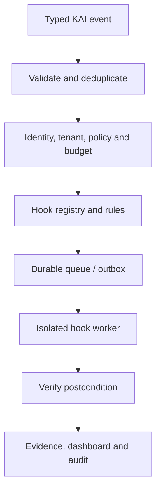

# KAI Hooks Master Build Plan

**Date:** 12 September 2026  
**Current browser status:** `BROWSER_EXECUTION_REVIEWED_AND_PASSING_LOCALLY`  
**Current hold:** Browser flag off, nothing deployed, 72-hour soak still running  

## 1. Objective

Build a single, governed event-and-hook layer that lets KAI react when something important happens across Wheellsverse without creating another brain or a collection of uncontrolled automations.

A hook is:

> A typed event plus conditions, policy, an allowed action, evidence, and a failure path.

Examples:

- A deployment fails → KAI collects logs, opens a draft incident, and alerts the owner.
- A subscription webhook arrives → KAI verifies its signature and idempotency before updating entitlement.
- A browser request targets a private address → KAI blocks it and records evidence.
- A mission stops producing heartbeats → KAI marks it stalled and recommends recovery.

KAI remains the sole authority. Hooks can observe, prepare, request approval, or execute a specifically approved low-risk action. Hooks cannot grant themselves permissions, activate capabilities, move money, deploy production, send mass outreach, or rewrite KAI policy.

## 2. Hook architecture



The hook service extends the existing Capability Fabric, Mission system, policy/approval controls, evidence system, OperationalSelfModel, HoldingDigitalTwin, Feature Registry, ModelRouter, KAI Presence, and Holding dashboard. It must not duplicate them.

### 2.1 Four authority modes

| Mode | What it may do | Examples |
|---|---|---|
| `OBSERVE` | Read, classify, measure, and record | Health check, security finding, usage metric |
| `DRAFT` | Produce an artifact that has no external effect | Draft email, incident, invoice review, content post |
| `APPROVAL_REQUIRED` | Pause with an exact proposed effect | Deploy, send, refund, schema change, account change |
| `SAFE_AUTOMATIC` | Execute a narrow reversible action pre-authorized by policy | Deduplicate event, quarantine download, stop expired worker |

`SAFE_AUTOMATIC` is not general autonomy. Each automatic action needs an explicit allowlisted operation, tenant, resource scope, ceiling, rollback, expiration, and owner.

### 2.2 Universal HookDefinition

Every hook should declare:

```yaml
id: deployment.failed.collect_evidence
version: 1
owner: holding-operations
event_type: deployment.failed.v1
mode: OBSERVE
conditions: []
tenant_scope: []
data_classes: []
required_permissions: []
allowed_effects: []
network_domains: []
secrets: []
timeout_seconds: 30
retry_policy: bounded_exponential
idempotency_template: "{event_id}:{hook_id}:{version}"
budget_policy: no_spend
approval_policy: null
evidence_contract: deployment_failure_v1
verification: logs_and_provider_status
rollback: null
kill_switch: KAI_HOOK_DEPLOYMENT_FAILURE_ENABLED
status: INERT
expires_at: null
```

Required runtime fields include `event_id`, `correlation_id`, `mission_id`, `tenant_id`, `principal`, `source`, `occurred_at`, `received_at`, `schema_version`, `payload_digest`, `trace_id`, and `causation_id`.

### 2.3 Delivery guarantees

- Use a transactional outbox so database state and event publication cannot silently diverge.
- Assume at-least-once delivery; every effect must be idempotent.
- Use bounded retries with retryable/non-retryable classification.
- Send poison events to a dead-letter queue; never retry forever.
- Propagate cancellation and STOP signals.
- Workers cannot mark their own mission successful without verifier evidence.
- Preserve causal chains to prevent hook loops.
- Cap cascade depth and event rate per tenant.
- Redact secrets and sensitive fields before evidence or notifications.
- Expire approvals and reject cross-mission or replayed approvals.

## 3. Complete hook catalog

### A. Mission lifecycle hooks

| Hook | Trigger | Result | Mode |
|---|---|---|---|
| Mission created | New mission | Validate owner, tenant, intent, budget, and requested effects | Observe |
| Mission preflight | Before queue | Produce policy and resource decision | Observe |
| Mission approval needed | Consequential effect found | Create exact approval request with expiry | Draft |
| Mission approved | Valid owner approval | Release only matching operation once | Safe automatic |
| Mission approval rejected | Owner rejects | Cancel pending effect and record reason | Safe automatic |
| Mission queued | Accepted mission | Assign allowed worker class | Safe automatic |
| Mission started | Worker claim | Record worker identity and lease | Observe |
| Mission heartbeat | Periodic worker signal | Refresh lease and health | Observe |
| Mission heartbeat missing | Lease expires | Mark stalled; stop new effects; draft recovery | Safe automatic |
| Mission checkpoint | Safe boundary reached | Persist resumable state and evidence digest | Safe automatic |
| Mission resumed | Valid recovery request | Resume from verified checkpoint | Approval required for consequential missions |
| Mission cancelled | User, policy, or STOP | Propagate cancellation to tools and child jobs | Safe automatic |
| Mission timed out | Deadline exceeded | Stop worker, quarantine late results | Safe automatic |
| Mission completed | Worker proposes completion | Independently verify postconditions | Observe |
| Mission failed | Non-retryable failure | Classify, collect evidence, propose remediation | Draft |
| Mission retry | Retryable failure | Enforce retry budget and backoff | Safe automatic |
| Mission duplicate | Same idempotency key | Return original result; do not execute twice | Safe automatic |
| Mission orphaned | Worker gone, lease exists | Reconcile and recover or terminate | Safe automatic |
| Mission cost threshold | Spend/token/time threshold | Pause and request continuation approval | Safe automatic |
| Global STOP | Owner emergency stop | Prevent all new effects and cancel allowed work | Safe automatic |

### B. Capability Exchange hooks

| Hook | Trigger | Result | Mode |
|---|---|---|---|
| Capability discovered | New source submitted | Create `DISCOVERED` record only | Observe |
| Source verified | Official source and revision resolved | Record source, pin, digest, and provenance | Observe |
| License review due | New/changed license | Block promotion pending review | Safe automatic |
| SBOM changed | Dependency graph changes | Run supply-chain review | Observe |
| Vulnerability detected | Scanner finding | Quarantine by severity and exposure | Safe automatic |
| Manifest invalid | Schema or required field failure | Reject activation | Safe automatic |
| Review complete | Security/legal/owner evidence present | Allow transition to `REVIEWED` only | Approval required |
| Lab promotion requested | Owner requests `LAB` | Verify isolation, budgets, and test plan | Approval required |
| Staging promotion requested | Passed lab | Verify conformance suite | Approval required |
| Production activation requested | Passed staging | Require named owner, deployment truth, rollback | Approval required |
| Capability health degraded | Error/latency threshold | Route away or mark unavailable | Safe automatic |
| Capability health recovered | Sustained recovery | Restore eligibility, not activation | Safe automatic |
| Capability expired | Review/pin expiry | Move to inert state | Safe automatic |
| Capability revoked | Owner/security revocation | Disable and block future calls | Safe automatic |
| Capability invocation | Broker selects adapter | Attach policy, budget, sandbox, evidence | Observe |
| Capability result | Adapter returns | Normalize and verify; distrust provider prose | Observe |
| Capability contract drift | Output/schema/version changes | Fail closed and quarantine | Safe automatic |
| Kill switch used | Owner disables capability | Cancel queued effects and record impact | Safe automatic |

### C. Identity, authorization, and tenant hooks

| Hook | Trigger | Result | Mode |
|---|---|---|---|
| Login risk detected | New device/location/rate anomaly | Step-up authentication or block | Safe automatic |
| Session revoked | Logout/security action | Invalidate session and dependent leases | Safe automatic |
| Role changed | Membership/role mutation | Recompute access and revoke stale grants | Safe automatic |
| Owner-only route called | Request enters protected route | Enforce shared server-side owner policy | Observe/block |
| Anonymous mutation attempted | No authenticated principal | Block, record, alert on threshold | Safe automatic |
| Cross-tenant access attempted | Object tenant mismatch | Block and create security event | Safe automatic |
| Confused-deputy risk | Connector identity differs from user intent | Block pending explicit delegation | Safe automatic |
| Forwarded-header anomaly | Untrusted host/proto forwarding | Reject or use trusted proxy metadata only | Safe automatic |
| Privilege drift | Route/tool scope expands | Disable affected feature flag | Safe automatic |
| Dormant privileged account | No use beyond policy window | Draft review/revocation request | Draft |

### D. Security and secret hooks

| Hook | Trigger | Result | Mode |
|---|---|---|---|
| Secret detected in commit | Pre-commit/CI scan | Block commit or CI artifact | Safe automatic |
| Secret detected in logs/evidence | Redaction scanner | Quarantine artifact and redact copy | Safe automatic |
| Credential nearing expiry | Rotation window | Notify owner and draft rotation plan | Draft |
| Credential scope too broad | Scope audit | Disable connector or request narrowing | Safe automatic |
| Untrusted test requests credentials | Test sandbox launch | Supply empty credentials and deny network | Safe automatic |
| Dependency advisory | New CVE/advisory | Assess reachability and quarantine when required | Observe/safe automatic |
| Signature/digest mismatch | Artifact load | Refuse execution | Safe automatic |
| CSP/security-header regression | Build or live probe | Block release and open finding | Safe automatic |
| CSRF/origin failure | Security test/runtime event | Block mutation and alert | Safe automatic |
| Rate-limit abuse | Threshold exceeded | Throttle principal/IP/tenant | Safe automatic |
| Prompt injection detected | Retrieved content/tool output | Label untrusted, prevent instruction elevation | Safe automatic |
| Suspicious data exfiltration | Output/domain/data-class mismatch | Block egress and quarantine mission | Safe automatic |
| Audit-chain discontinuity | Missing/hash-mismatched event | Halt affected authority path | Safe automatic |
| Security finding overdue | SLA exceeded | Escalate to Holding dashboard | Observe |

### E. Governed browser hooks

These hooks should not be changed or activated until the current 72-hour soak completes and its evidence is sealed.

| Hook | Trigger | Result | Mode |
|---|---|---|---|
| Browser session requested | Mission needs browser | Check domain, identity, risk, approval, profile isolation | Observe |
| Navigation requested | URL/redirect | Apply scheme, host, port, DNS, IP-pin, private/metadata policy | Safe automatic |
| Redirect encountered | HTTP/browser redirect | Re-run full destination policy | Safe automatic |
| WebSocket requested | `ws://` or `wss://` | Apply the same host/port/IP/private checks | Safe automatic |
| Service worker requested | Registration/start | Block unless a separately certified profile permits it | Safe automatic |
| WebRTC API requested | Peer connection/data channel | Remove/block according to browser profile | Safe automatic |
| `context.request` used | Playwright API request | Route through governed network policy | Safe automatic |
| Download started | Browser download | Quarantine file, hash, scan, size/type check | Safe automatic |
| Upload requested | File leaves KAI | Verify user intent, domain, data class, and approval | Approval required |
| Credential field detected | Password/payment/token UI | Pause for user-controlled entry; no evidence capture | Approval required |
| Consequential click detected | Purchase/send/delete/submit | Show exact target and effect | Approval required |
| Page content injection | Hostile instruction in DOM | Treat as data; block authority escalation | Safe automatic |
| Browser STOP | User/policy stop | Close contexts, workers, listeners, temp profiles | Safe automatic |
| Browser cleanup failed | Residual resource found | Quarantine worker and fail mission | Safe automatic |
| Browser evidence captured | Action completed | Redact screenshot/DOM/trace and hash evidence | Observe |

### F. Coding and repository hooks

| Hook | Trigger | Result | Mode |
|---|---|---|---|
| Worktree created | Coding mission starts | Verify isolated path, base SHA, clean state | Observe |
| Instructions discovered | `AGENTS.md`/project rules | Attach relevant rules to mission | Observe |
| Protected branch targeted | Push/commit plan | Block direct write | Safe automatic |
| Unrelated dirty files found | Pre-edit check | Stop or isolate work | Safe automatic |
| Dependency added | Manifest/lock changes | Require reason, license, pin, and scan | Approval required |
| Migration added | Schema change | Require reversible migration and isolated DB test | Approval required |
| Route added/removed | Router diff | Update machine route inventory and auth tests | Safe automatic |
| Test failure | CI/local suite | Classify failure; prevent false success | Observe |
| Coverage/contract regression | Gate threshold fails | Block merge recommendation | Safe automatic |
| Generated file changed | Build/codegen output | Verify source and deterministic regeneration | Observe |
| Commit requested | Logical unit complete | Scan secrets, diff, tests, and message | Approval required when push follows |
| Pull request opened | Review boundary | Attach test/evidence matrix and known risks | Draft |
| Review finding created | Independent review | Link finding to code/evidence and block approval by severity | Observe |
| Review finding resolved | Fix plus regression test | Mark resolved only with evidence | Observe |
| Merge requested | All gates appear green | Recheck base drift, approvals, SHA, and deployment scope | Approval required |

### G. Deployment, infrastructure, and operations hooks

| Hook | Trigger | Result | Mode |
|---|---|---|---|
| Build started | CI/deploy begins | Record source SHA and environment | Observe |
| Build failed | Provider reports failure | Collect logs, classify, draft incident | Draft |
| Build succeeded | Artifact produced | Verify artifact digest/SBOM, not production health | Observe |
| Deployment requested | Release action | Require environment, SHA, flags, migration, rollback approval | Approval required |
| Deployment completed | Provider says success | Probe routes, bytes, health, migrations, flags, and SHA | Observe |
| Deployment drift | Running SHA/config differs | Alert and block further promotion | Safe automatic |
| Health check failed | Repeated failure | Open incident; optionally route traffic away | Safe automatic if pre-authorized |
| Error budget breached | SLO window breached | Freeze releases and escalate | Safe automatic |
| Rollback threshold met | Certified failure condition | Propose or perform pre-authorized rollback | Approval required by default |
| Migration mismatch | Runtime schema differs | Stop release and protect writes | Safe automatic |
| Feature flag changed | Authority flag mutation | Record actor, old/new value, reason, and runtime observation | Observe |
| Authority flag unexpectedly on | Drift monitor | Disable if explicitly pre-authorized; otherwise urgent approval | Safe automatic/approval |
| Cron heartbeat missing | Scheduler misses windows | Alert, inspect scheduler and last successful job | Observe |
| Cron delivery failure | Notification/API failure | Deduplicate, retry boundedly, then escalate | Safe automatic |
| Queue backlog high | Depth/age threshold | Scale within ceiling or pause intake | Approval required unless bounded policy exists |
| Database health degraded | Connections/replication/migrations | Protect writes and alert | Safe automatic |
| Backup verification due | Scheduled | Restore to isolated environment and verify | Observe |
| Certificate/domain expiry | Expiry window | Alert with renewal plan | Draft |
| Cost anomaly | Daily/monthly spend deviation | Pause optional workloads and alert | Safe automatic within policy |

### H. ModelRouter and AI-provider hooks

| Hook | Trigger | Result | Mode |
|---|---|---|---|
| Model request | KAI needs inference | Select by task, data class, region, quality, health, budget | Observe |
| Provider timeout | Request exceeds limit | Cancel and route only to approved fallback | Safe automatic |
| Provider quota low | Remaining quota threshold | Shift eligible traffic and alert | Safe automatic |
| Provider cost threshold | Budget limit | Downgrade optional workload or pause | Safe automatic |
| Provider quality regression | Eval/canary falls | Remove from eligible route set | Safe automatic |
| Context overflow risk | Prompt estimate exceeds model | Compress/retrieve under provenance rules | Safe automatic |
| Sensitive-data route | Restricted data present | Force approved private provider or refuse | Safe automatic |
| Silent fallback attempted | Provider error path | Block unreported fallback and expose actual provider | Safe automatic |
| Model/version changed | Provider revision drift | Require re-evaluation | Safe automatic |
| Local model unavailable | Hardware/runtime health failure | Report unavailable; never pretend it ran | Observe |
| Hallucination/verification conflict | Output contradicts source/tool | Mark uncertain and request verification | Observe |

### I. Memory, RAG, and knowledge hooks

| Hook | Trigger | Result | Mode |
|---|---|---|---|
| Memory proposed | Model/mission extracts fact | Validate consent, provenance, subject, tenant, confidence | Draft |
| Memory accepted | KAI memory policy approves | Store canonical version with source | Safe automatic |
| Memory contradiction | New fact conflicts | Keep versions and request resolution | Draft |
| Memory corrected | User provides correction | Supersede old value, preserve audit | Safe automatic |
| Memory deletion requested | User/privacy request | Delete from stores and verify propagation | Approval required |
| Memory expired | TTL reached | Delete or archive per policy | Safe automatic |
| Document uploaded | New knowledge source | Scan, classify, hash, parse in sandbox | Safe automatic |
| Document ingestion failed | Parser/OCR error | Quarantine and report exact limitation | Observe |
| Knowledge indexed | Chunks/embeddings ready | Verify counts, tenant, source links, deletion map | Observe |
| Source changed | Watched document/page changes | Create version and mark stale citations | Observe |
| Retrieval executed | RAG query | Record sources, versions, scores, and filters | Observe |
| Retrieval confidence low | Evidence insufficient | Ask for source or state uncertainty | Observe |
| Cross-tenant retrieval attempted | Tenant filter mismatch | Block and create security event | Safe automatic |

### J. Voice, messaging, and user-experience hooks

| Hook | Trigger | Result | Mode |
|---|---|---|---|
| Voice session started | Microphone session | Verify identity, consent, device, retention | Observe |
| User speech started | VAD event | Stop current TTS and supersede stale turn | Safe automatic |
| Transcript finalized | STT final result | Route to the same KAI turn processor as text | Safe automatic |
| Ambiguous command | Low confidence/consequential speech | Ask for explicit confirmation | Draft |
| TTS started/stopped | Audio lifecycle | Record latency and cancellation | Observe |
| Stale voice result | Cancelled turn returns | Quarantine result; never speak or execute | Safe automatic |
| Notification proposed | Mission wants user alert | Select channel based on urgency/preferences | Draft |
| Notification deduplicated | Same event already delivered | Suppress duplicate | Safe automatic |
| Recipient required | Email/message/action | Resolve exact person/account before approval | Approval required |
| Message send requested | External communication | Show recipient, channel, body, attachments | Approval required |
| Message delivered/failed | Provider receipt | Record receipt or bounded retry | Observe/safe automatic |
| Accessibility regression | UI automated/manual audit | Block release recommendation | Observe |
| Empty/error/loading state | UI runtime event | Record product issue with context | Observe |

### K. Billing, subscriptions, and money hooks

These remain `MONEY_MODE=MOCK` or read-only until separately authorized.

| Hook | Trigger | Result | Mode |
|---|---|---|---|
| Payment webhook received | Stripe/Dwolla/etc. event | Verify signature, timestamp, environment, and event type | Safe automatic |
| Webhook duplicate | Replayed event ID | Return prior result; no second effect | Safe automatic |
| Checkout completed | Verified event | Reconcile customer, price, payment status, entitlement | Safe automatic within existing billing policy |
| Subscription changed | Verified provider state | Update entitlement without demoting valid payers | Safe automatic |
| Tier-heal discrepancy | Local/provider mismatch | Preserve active payer; create reconciliation case | Draft |
| Refund requested | User/admin request | Validate amount, transaction, policy, and approval | Approval required |
| Payout requested | Business action | Verify settlement, beneficiary, limits, sanctions/KYC dependencies | Approval required |
| Duplicate payout risk | Same obligation/effect | Block and alert | Safe automatic |
| Invoice received | Email/upload | Extract and draft payable record | Draft |
| Invoice anomaly | Duplicate/vendor/amount/tax mismatch | Hold and request review | Safe automatic |
| Budget ceiling reached | Project/service spend | Block additional optional spend | Safe automatic |
| Revenue event verified | Provider settlement | Update Holding metrics with provenance | Observe |
| Financial execution attempted | Any live order/transfer without authority | Block and record | Safe automatic |

### L. SOL hooks

| Hook | Trigger | Result | Mode |
|---|---|---|---|
| Circle created | Valid owner request | Validate cadence, capacity, dates, and policy | Approval required |
| Member invited | Invitation request | Validate identity, circle, expiry, and capacity | Approval required |
| Fifth paid member reached | Verified successful payments | Close further acceptance per current rule | Safe automatic |
| Payment due | Scheduled date | Draft reminder; sending follows consent policy | Draft |
| Payment confirmed | Verified provider settlement | Update obligation once | Safe automatic |
| Payment failed | Verified failure | Notify member, never advance payout eligibility | Draft |
| Eligibility reached | Two successful payments | Mark eligible; do not automatically pay | Safe automatic |
| Payout date approaching | Schedule | Run settlement and compliance preflight | Observe |
| Payout requested | Eligible member/action | Require approval and settlement proof | Approval required |
| Circle imbalance | Obligations and funds differ | Freeze payout and escalate | Safe automatic |
| Subscription checkout duplicate | Repeat click/session | Reuse or reject duplicate checkout | Safe automatic |

### M. Holding CEO and business-operation hooks

| Hook | Trigger | Result | Mode |
|---|---|---|---|
| Daily executive briefing | Schedule | Summarize health, revenue, risks, decisions, blockers | Draft |
| Critical risk detected | Security/finance/availability | Immediate owner alert with evidence | Observe |
| Decision required | Mission cannot proceed safely | Create decision card with options/tradeoffs | Draft |
| KPI threshold crossed | Valid metric movement | Explain drivers and confidence | Observe |
| Revenue opportunity detected | Product/customer signal | Draft experiment, cost, and success measure | Draft |
| Customer churn signal | Subscription/usage pattern | Draft retention action; no automatic outreach | Draft |
| Support backlog high | Queue threshold | Prioritize and propose staffing/automation | Draft |
| Lead discovered | Approved source | Enrich with provenance and consent constraints | Draft |
| Outreach approved | Named recipient/message | Send once and store receipt | Approval required |
| Content idea detected | Trend/customer question | Draft platform-specific content | Draft |
| Content publication requested | Approved artifact | Require final preview and destination approval | Approval required |
| Contract/compliance deadline | Calendar/document event | Alert and create checklist | Draft |
| Company status changed | Registry/bank/provider update | Update Digital Twin after verification | Observe |
| Project blocked | Blocker exceeds SLA | Escalate with owner and next action | Observe |
| Project completed | Evidence verifies outcome | Update roadmap and archive artifacts | Observe |

### N. Data quality and analytics hooks

| Hook | Trigger | Result | Mode |
|---|---|---|---|
| Schema drift | Columns/types/contracts change | Block dependent reports and alert | Safe automatic |
| Freshness breach | Dataset not updated | Mark dashboard stale | Safe automatic |
| Duplicate records | Uniqueness check fails | Quarantine affected batch | Safe automatic |
| Missingness spike | Null rate threshold | Open data-quality incident | Observe |
| Broken join | Match rate drops | Stop KPI publication | Safe automatic |
| Metric definition changed | Semantic-layer revision | Require owner review and versioned restatement | Approval required |
| KPI anomaly | Statistical/business threshold | Diagnose likely drivers with evidence | Observe |
| Dashboard query expensive | Cost/runtime threshold | Cancel and propose optimization | Safe automatic |
| Export requested | Data leaves system | Verify scope, recipient, classification, and approval | Approval required |
| PII detected unexpectedly | Scanner/classifier | Quarantine and correct classification | Safe automatic |

### O. Device and computer-operation hooks

Do not activate these until one real Mac is enrolled, authenticated, signed, TCC-ready, connected, and explicitly authorized. Those states remain separate.

| Hook | Trigger | Result | Mode |
|---|---|---|---|
| Device enrollment requested | New device | Verify owner, attestation, identity, and intended scopes | Approval required |
| Device connected | Authenticated heartbeat | Report connectivity only | Observe |
| Device identity changed | Binary/signature/device drift | Revoke execution eligibility | Safe automatic |
| TCC readiness changed | macOS permission state | Update readiness, never auto-grant | Observe |
| Read-only observation requested | Screen/window query | Require narrow mission and evidence policy | Approval required during certification |
| App-open requested | Approved local application | Require immediate mission-bound approval | Approval required |
| Filesystem write requested | Local mutation | Block until a separately certified capability exists | Prohibited initially |
| Shell requested | Arbitrary command | Block until separately designed and authorized | Prohibited initially |
| Credential entry requested | Sensitive UI | Return control to the human | Approval required |
| Device STOP | Owner/global stop | Prevent new actions and terminate allowed worker | Safe automatic |
| Device evidence returned | Worker reports result | Verify identity, mission, timestamps, and postcondition | Observe |
| Device goes offline | Heartbeat expiry | Mark offline; do not mark mission complete | Safe automatic |

### P. Learning and self-improvement hooks

| Hook | Trigger | Result | Mode |
|---|---|---|---|
| Repeated failure pattern | Similar verified failures | Draft a candidate rule/test | Draft |
| User correction | User corrects KAI | Link correction to affected behavior and propose update | Draft |
| Successful workflow repeated | Consistent evidence | Propose a reusable skill/template | Draft |
| Candidate skill generated | Learning pipeline output | Send through skill admission review | Observe |
| Evaluation improved | Controlled benchmark | Draft promotion proposal | Draft |
| Evaluation regressed | Canary/eval failure | Disable candidate and preserve baseline | Safe automatic |
| Prompt/policy change proposed | Learning output | Require diff, tests, and human approval | Approval required |
| Self-modification attempted | Runtime tries to alter authority | Block and create critical finding | Safe automatic |
| Canary completed | Dark/canary run ends | Compare against baseline and explain uncertainty | Observe |
| Rollback triggered | Regression or safety threshold | Restore last verified version | Safe automatic only when pre-authorized |

## 4. What to build first

### Phase 0 — finish and seal the browser soak

Do not modify the browser branch or soak environment. When the 72-hour run ends, capture duration, supervisor continuity, database health, and all required zero counters. If clean, tag the final evidence and advance only to `BROWSER_EXECUTION_CERTIFIED_LOCALLY`. Do not deploy or enable the browser flag from that result alone.

### Phase 1 — inert hook foundation

Build in a fresh isolated worktree after verifying the correct base SHA:

1. Versioned `EventEnvelope` and `HookDefinition` schemas.
2. Hook Registry integrated with the existing Feature/Capability Registry.
3. Transactional outbox and durable queue.
4. Idempotency and replay protection.
5. Shared policy, tenant, identity, budget, and approval middleware.
6. Isolated hook worker contract with credential/network scoping.
7. Evidence and independent verifier contracts.
8. Retry, dead-letter, cancellation, timeout, lease, heartbeat, and checkpoint behavior.
9. Cascade-depth and loop prevention.
10. Per-hook kill switch, quarantine, expiry, and rollback metadata.
11. Holding dashboard pages for hook status, last event, failures, evidence, and controls.
12. All hooks inert/off by default.

### Phase 2 — safety and observability hooks

Implement first:

- anonymous mutation blocker;
- shared owner/tenant authorization hook;
- route-inventory drift hook;
- forwarded-header/CSRF trust hook;
- credential inheritance blocker for tests;
- secret/log/evidence redaction hook;
- deployment SHA/config drift hook;
- build/deployment failure evidence hook;
- feature/authority flag change hook;
- cron heartbeat and cron-death hook;
- database health and migration mismatch hook;
- mission heartbeat, timeout, orphan, and STOP hooks;
- audit-chain integrity hook;
- budget-ceiling hook.

These directly address known KAI/Wheellsverse risks and improve truth without granting new external authority.

### Phase 3 — engineering hooks

Add isolated worktree checks, dependency/license admission, migration verification, route inventory, test/evidence matrices, review-finding lifecycle, base-drift checks, protected-branch blocking, and merge-readiness summaries.

### Phase 4 — read-only business hooks

Add daily CEO briefing, critical-risk escalation, project-blocker cards, verified revenue observations, support triage, invoice extraction, data-quality alerts, and KPI anomalies. Outputs remain dashboard entries or drafts.

### Phase 5 — approval-gated business effects

Add named-recipient messaging, content publishing, deployment, refunds, payouts, subscription corrections, and infrastructure changes. Each exact effect needs fresh approval, idempotency, provider receipt, independent verification, and rollback where possible.

### Phase 6 — browser, voice, models, and memory

Connect the already certified components through the Hook Registry one domain at a time. Browser hooks come only after the soak certificate; voice uses the same KAI turn path; memory providers can propose but not authoritatively accept facts; ModelRouter owns every provider decision.

### Phase 7 — one-Mac device pilot

Only after signing, TCC, attestation, enrollment, and explicit authorization, certify read-only desktop observation and one reversible app-open action. Keep arbitrary shell, unrestricted filesystem, credential entry, purchasing, deployment, and financial operations blocked.

### Phase 8 — bounded learning

Allow KAI to propose new tests, skills, or routing changes from evidence. Generated changes remain inert until independent evaluation and human approval. No hook can modify policy or activate itself.

## 5. Initial high-value hook pack

The first production candidate should contain only these 20 hooks:

1. `mission.created.validate`
2. `mission.heartbeat.missing`
3. `mission.timeout.stop`
4. `mission.duplicate.suppress`
5. `mission.completed.verify`
6. `global.stop.enforce`
7. `auth.anonymous_mutation.block`
8. `auth.cross_tenant.block`
9. `auth.owner_route.enforce`
10. `security.secret_redact`
11. `security.audit_chain.verify`
12. `test.credentials_and_network.deny`
13. `routes.inventory.drift`
14. `deployment.failed.collect_evidence`
15. `deployment.runtime_sha.drift`
16. `feature_flag.authority_change.audit`
17. `cron.heartbeat.missing`
18. `database.migration.mismatch`
19. `budget.ceiling.pause`
20. `incident.owner_alert.draft`

Only blocking, containment, evidence, and internal-draft behavior should be eligible for automatic execution in this pack.

## 6. Certification matrix

Before activation, prove:

```text
KAI HOOK FOUNDATION CERTIFICATION

Schema-invalid events rejected                 PASS
Unknown hook versions rejected                 PASS
Cross-tenant events blocked                    PASS
Anonymous mutations blocked                    PASS
Owner-only mutations enforced on every route  PASS

Duplicate events executed more than once       0
Approval replay winners                        exactly 1
Expired approvals executed                     0
Cross-mission approvals executed               0
Hook loops beyond cascade limit                0

Secrets in logs/evidence                       0
Untrusted tests with real credentials          0
Untrusted tests with unrestricted network      0
Provider output changing KAI authority         0

Worker false-completion accepted               0
Unverified external effects marked complete    0
Orphan workers after cleanup                    0
Dead-letter events silently discarded          0

Kill switch                                    PASS
Cancellation propagation                       PASS
Timeout enforcement                            PASS
Budget enforcement                             PASS
Audit-chain verification                       PASS
Rollback rehearsal                             PASS

All external-effect hooks                      OFF
Money mode                                     MOCK
Browser execution                              OFF until separately authorized
Device execution                               OFF

FINAL: HOOK_FOUNDATION_CERTIFIED / FAILED
```

## 7. Immediate next action

Right now:

1. Leave the browser soak untouched until it finishes.
2. Do not deploy or enable browser execution.
3. Verify and close the outstanding global Stage 0 findings before adding new authority.
4. Prepare a fresh Claude Code session and isolated worktree for **Phase 1: inert hook foundation**.
5. Build schemas, registry, queue/outbox, policy/evidence integration, dashboard, and tests only.
6. Do not connect GitHub, Sentry, Stripe, email, browser, devices, finance, or any third party in Phase 1.

The correct first deliverable is not “hundreds of running automations.” It is a hook system that can prove exactly why a reaction happened, what it was allowed to do, whether it happened once, how it was verified, and how to stop it.

## 8. Complete framework and technology stack

This is the target stack for the hook platform. “Required” means part of the
first certified implementation. “Conditional” means install it only when its
phase and use case arrive. Existing working KAI components should be extended,
not rewritten merely to match this list.

### 8.1 Architecture decision

| Layer | Selected framework or technology | Status | Role |
| --- | --- | --- | --- |
| Holding/operator web UI | **Angular + TypeScript** | Required | Hook registry, mission timeline, approvals, evidence, incidents, health and configuration |
| Angular UI foundation | Angular Router, HttpClient, Forms, Signals, CDK/Material | Required | Navigation, typed API calls, forms, reactive state, accessibility and operator components |
| Public/product frontends | Preserve the existing frontend stack | Required constraint | Do not rewrite SOL, KAI chat or public sites as part of the hook mission |
| Backend/API | **FastAPI + Python** | Required | KAI authority plane, hook APIs, policies, approvals and evidence endpoints |
| Contracts | Pydantic + JSON Schema + OpenAPI | Required | One typed contract from event ingestion through Angular client generation |
| Persistence | PostgreSQL + SQLAlchemy + Alembic | Required | Durable events, definitions, executions, approvals, evidence and audit state |
| Fast coordination | Redis | Required if already provisioned | Short-lived locks, leases, cache and rate limits; never the system of record |
| Event reliability | Transactional outbox + existing worker framework | Required | Durable event publication and at-least-once processing |
| Workflow engine | Temporal | Conditional, later | Only for proven multi-day workflows that outgrow the existing mission engine |
| Browser execution | Playwright | Existing, governed | Browser adapter and certification only; keep disabled until separately authorized |
| Testing | pytest, Hypothesis, Playwright Test | Required | Unit, property, integration, race, browser and end-to-end certification |
| Observability | OpenTelemetry | Required | Correlated traces, metrics and logs across mission, hook, worker and external effect |
| Metrics/dashboard backend | Prometheus-compatible metrics + Grafana or current platform | Conditional | Operational trends and alerts; Holding remains the primary operator view |
| Error tracking | Sentry SDK | Conditional | Exception grouping and debugging after secrets/redaction controls are proven |
| Policy | Existing KAI policy engine; OPA only if needed later | Required constraint | Do not introduce a second authority plane |
| Authentication | Existing owner/session/device principal system | Required constraint | One identity and tenant model across UI, API, worker, browser and device paths |
| Packaging | Docker | Required | Reproducible API, worker, migration and test environments |
| CI/CD | GitHub Actions + existing Railway/Cloudflare pipeline | Required | Static checks, tests, migrations, artifact identity, staged release and rollback |
| Mobile | React Native/Expo or native Swift/Kotlin | Conditional | Add only for a real mobile client; Angular web remains responsive/PWA-capable |
| Desktop agent | Native Swift/AppKit where macOS trust is required | Conditional | Signed device worker, TCC integration and one-Mac pilot |
| AI/model access | Existing KAI ModelRouter | Required constraint | Providers and local models remain workers, never decision authorities |
| Memory/RAG | Existing memory layer + pgvector/approved vector store | Conditional | Add retrieval only after tenant isolation, provenance and deletion pass |
| Infrastructure as code | Terraform/OpenTofu | Conditional | Adopt when infrastructure drift cannot be safely managed by current deployment config |

### 8.2 Angular implementation profile

Angular belongs in the **Holding and KAI operator console**, where a structured,
long-lived application benefits from dependency injection, routing, forms,
typed services and consistent component boundaries.

Use:

- Angular standalone components;
- TypeScript strict mode;
- Angular Router with route-level authorization guards;
- HttpClient with one authentication/tenant interceptor;
- Angular Signals for local and shared operator state;
- RxJS for streams, cancellation, reconnects and server events;
- Angular CDK for overlays, focus management, tables and accessible primitives;
- Angular Material selectively for dependable operator controls;
- CSS custom properties/design tokens for the Wheellsverse design system;
- generated TypeScript clients from KAI's OpenAPI document;
- server-sent events or governed WebSockets for live mission status;
- Playwright for browser-level UI certification;
- Angular's supported unit-test runner for component and service tests.

Recommended Angular feature areas:

```text
src/app/
  core/                 identity, API client, interceptors, route guards
  shell/                navigation, command bar, global STOP, alerts
  hooks/                registry, definitions, versions, promotion
  missions/             mission queue, lifecycle, checkpoints, results
  approvals/            approval inbox, expiry, scope and evidence
  evidence/             immutable timeline, artifacts, verification
  capabilities/         Capability Exchange inventory and health
  incidents/            quarantine, dead letters, remediation status
  operations/           deploys, jobs, cron, database and infrastructure
  models/               ModelRouter status, cost, latency and quality
  security/             sessions, devices, findings and audit integrity
  holding/              CEO briefing, KPIs, companies and decision cards
  shared/               design-system components and typed utilities
```

Do not:

- place policy decisions in Angular;
- trust a route guard as backend authorization;
- store approval tokens or provider secrets in browser storage;
- allow the dashboard to directly invoke workers;
- make Angular infer `COMPLETED` from optimistic UI state;
- mix Angular, React and Vue inside the same operator application;
- rewrite existing production pages during the hook-foundation phase.

### 8.3 Backend and contract frameworks

Required Python stack:

| Framework | Purpose |
| --- | --- |
| FastAPI | Versioned HTTP/SSE/WebSocket API boundary |
| Pydantic | Strict request, event, policy and evidence validation |
| SQLAlchemy | Explicit persistence and transaction boundaries |
| Alembic | Reviewed, reversible database migrations |
| Uvicorn | ASGI serving; production process management stays in deployment config |
| HTTPX | Time-bounded outbound HTTP and integration tests |
| pytest | Unit, integration and certification tests |
| Hypothesis | Property tests for schemas, idempotency, replay and policy invariants |
| structlog or existing structured logger | Correlated, redacted JSON logs |
| OpenTelemetry SDK | Traces, metrics, logs and context propagation |

Contract rules:

1. Pydantic models are the canonical server-side contracts.
2. FastAPI publishes OpenAPI and JSON Schema.
3. The Angular client and types are generated from that OpenAPI output.
4. CI fails when generated clients drift from backend contracts.
5. Every event includes `event_id`, `event_type`, `schema_version`, `tenant_id`,
   `actor_id`, `mission_id`, `causation_id`, `correlation_id`, timestamps and
   sensitivity classification.
6. Unknown fields, unsupported versions and missing authority context fail closed.

### 8.4 Event, queue and workflow frameworks

Begin with the repository's existing mission/worker system plus a PostgreSQL
transactional outbox. Add frameworks only when measurements justify them.

| Need | First choice | Upgrade condition |
| --- | --- | --- |
| Durable event capture | PostgreSQL transactional outbox | Always required |
| Worker delivery | Existing worker queue | Keep while retries, leases and cancellation can be certified |
| Short locks/leases | Redis | Use bounded TTLs; durable truth stays in PostgreSQL |
| Scheduled hooks | Existing scheduler with heartbeat evidence | Replace only if missed schedules remain unmanageable |
| Multi-day orchestration | Existing Mission system | Consider Temporal after workflow complexity is proven |
| High-volume streaming | Not initially required | Consider Kafka/Redpanda only with measured throughput need |
| Local development broker | Docker Compose services | Must mirror production semantics closely enough for certification |

Do not install Kafka, RabbitMQ, Celery and Temporal together. Pick one delivery
path behind a KAI-owned adapter after inspecting what the repository already uses.

### 8.5 Data and storage frameworks

- PostgreSQL is the authoritative database.
- Redis is disposable coordination/cache state only.
- Object storage stores large evidence artifacts using content hashes and
  tenant-scoped keys.
- pgvector is preferred if vector retrieval is needed and PostgreSQL can meet
  measured scale; do not add a separate vector database by default.
- SQL migrations must include forward, rollback or compensating procedure,
  tenant checks and data-quality assertions.
- Evidence uses append-only records and hash-chain verification; object storage
  alone is not proof of integrity.
- Backups require automated restore tests, not only successful backup jobs.

### 8.6 Security frameworks and standards

Use standards and narrow libraries rather than a parallel security product:

- OAuth 2.1/OIDC where external identity federation is genuinely required;
- secure server sessions for the current owner console;
- WebAuthn/passkeys as a later strong-auth option;
- Argon2id for locally managed password hashing;
- signed, expiring, mission-scoped approval tokens;
- KMS/secret-manager-backed encryption in deployed environments;
- Semgrep or equivalent static security rules;
- dependency and container scanning;
- CycloneDX/SPDX software bills of materials;
- Sigstore/Cosign for release artifact signing when the pipeline is ready;
- Content Security Policy, trusted origins, CSRF protection and strict cookies;
- existing egress policy for HTTP, redirects, DNS/IP pinning, WebSockets,
  service workers, WebRTC and programmatic request clients.

OPA is optional. Introduce it only if the existing KAI policy system cannot
express or test the required rules. If used, KAI remains the policy owner and
OPA is only the evaluation engine.

### 8.7 Observability and evidence frameworks

OpenTelemetry is the common instrumentation layer because it can correlate
logs, metrics and distributed traces without tying KAI to one backend.

Every trace should carry, where safe:

- tenant, actor and device principal identifiers;
- mission, hook execution, correlation and causation identifiers;
- capability and provider names;
- policy and approval decision references;
- retry, lease, checkpoint and cancellation state;
- cost/budget counters;
- evidence and verification references;
- deployment SHA and configuration fingerprint.

Telemetry must pass through redaction before export. Raw prompts, secrets,
session tokens, uploaded files and sensitive user data must not become labels
or unrestricted log fields.

### 8.8 Test and certification frameworks

| Test layer | Framework |
| --- | --- |
| Python unit/integration | pytest |
| Property and state-machine tests | Hypothesis |
| Angular unit/component | Angular-supported test runner |
| API contract | OpenAPI schema checks + generated-client drift test |
| Browser E2E | Playwright Test |
| Load/concurrency | Locust or k6, chosen once |
| Security regression | Semgrep plus repository-specific adversarial tests |
| Dependency/container | Dependabot/Renovate plus an image scanner |
| Migration | Ephemeral PostgreSQL forward/rollback/restore tests |
| Failure injection | Repository-owned fault harness; Chaos Mesh only if Kubernetes is later adopted |

Mutation testing is valuable for the policy, approval, idempotency and verifier
modules. It is optional elsewhere until the critical foundation is certified.

### 8.9 Deployment and infrastructure frameworks

Keep the current deployment model:

- GitHub for source and reviewed changes;
- GitHub Actions for CI certification;
- Docker images with pinned dependencies and non-root runtime users;
- Railway for current API/worker deployment where already used;
- Cloudflare for DNS/static delivery where already used;
- PostgreSQL and Redis as isolated staging/production services;
- feature flags for authority-bearing capabilities;
- deployment SHA/configuration truth displayed in Holding;
- health, readiness and dependency checks separated;
- tested instant disable and rollback paths.

Kubernetes is **not required** for the current scale. Add it only if multiple
services, replicas, isolation or scheduling requirements exceed what the current
platform can operate safely. Terraform/OpenTofu should likewise follow a real
infrastructure-reproducibility need, not precede it.

### 8.10 Mobile, desktop and device frameworks

| Target | Framework choice | Rule |
| --- | --- | --- |
| Responsive operator access | Angular PWA | First mobile-access path |
| Cross-platform consumer app | React Native + Expo | Conditional; preserve existing mobile work if present |
| Deep iOS/macOS integration | Swift + SwiftUI/AppKit | Use for signing, keychain, TCC and native device control |
| Android-native integration | Kotlin + Jetpack Compose | Add only when Android-specific capability is needed |
| Local worker protocol | Existing signed device-principal protocol | No generic remote shell |

Do not use Flutter, React Native and native Swift/Kotlin for the same first
client. Choose based on the actual product surface. The KAI computer-operations
pilot remains native/trusted where macOS identity and TCC require it.

### 8.11 AI, RAG and agent frameworks

The required framework is KAI's existing ModelRouter, Capability Fabric,
Mission system and evidence boundary. LangChain, LlamaIndex, AutoGen,
CrewAI and similar orchestration frameworks are **not required** and must not
be allowed to form a second brain or authority plane.

Conditional libraries may be used behind adapters for:

- model-provider SDK calls;
- token counting and structured outputs;
- document parsing and chunking;
- embeddings and pgvector retrieval;
- evaluation datasets and judge-independent scoring;
- local inference through Ollama/vLLM-compatible adapters when hardware permits.

All model calls inherit KAI policy, tenant scope, budget, timeout, cancellation,
evidence and verification. Provider fallback must be explicit and recorded.

### 8.12 Frameworks explicitly not needed now

- A second backend framework such as Django, Flask, NestJS or Spring Boot.
- A second operator UI framework such as React, Vue or Svelte beside Angular.
- Kubernetes before operational scale requires it.
- Kafka/Redpanda before measured event volume requires streaming infrastructure.
- Multiple job queues or workflow engines.
- A separate vector database before pgvector is measured and found insufficient.
- A general autonomous-agent framework that bypasses KAI missions and policy.
- Blockchain for hook evidence; signed/hash-chained conventional evidence is enough.
- Real-money trading frameworks in the hook foundation.
- Unrestricted MCP servers with production credentials.

### 8.13 Framework adoption order

1. Inspect and inventory the frameworks and versions already present.
2. Freeze the contract: Pydantic, JSON Schema and OpenAPI.
3. Add the PostgreSQL hook schema and transactional outbox.
4. Extend the existing worker system with idempotency, leases and cancellation.
5. Add OpenTelemetry correlation and evidence verification.
6. Build the Angular operator console against generated API clients.
7. Add pytest, Hypothesis and Playwright certification gates.
8. Integrate deployment truth and rollback into Holding.
9. Evaluate optional frameworks only after a measured need appears.

### 8.14 Official framework references

- Angular: https://angular.dev/
- FastAPI: https://fastapi.tiangolo.com/
- Playwright: https://playwright.dev/
- OpenTelemetry: https://opentelemetry.io/

Pin exact versions from supported releases during implementation and commit the
lockfiles. Do not encode a floating `latest` dependency into production builds.
